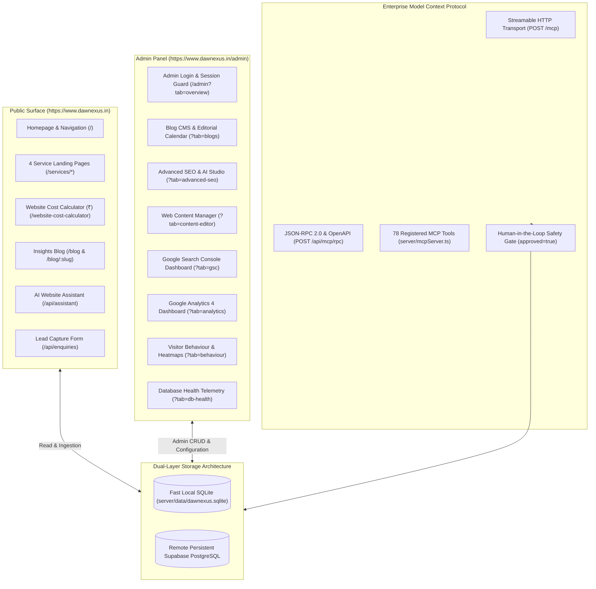

# Dawnexus — Complete System Architecture, Features & Operations Guide

**System Version:** 8.3.0 Production Baseline  
**Inspected Commit:** `e51b0240be6b8a00e491909013475be062c92f5b` (`main` branch)  
**Production Domain:** `https://www.dawnexus.in`  
**Classification:** Comprehensive End-to-End Technical Documentation Draft (For Owner Review)  
**Last Verified:** October 23, 2026

---

## Welcome & System Purpose

This documentation suite provides a complete, code-grounded explanation of the Dawnexus application, backend services, database models, Model Context Protocol (MCP) server, administrative operations, and automated workflows.

It is designed to give the business owner, new software engineers, and autonomous coding AI assistants full visibility into the system without having to rediscover the architecture from scratch.

> **Operational Safety Rule:** All documentation is grounded directly in the inspected codebase. Do not execute write operations, create test records, or modify production configurations merely to document or discover functionality.

---

## Complete Documentation Index

| Section / Topic | Supporting Documentation File | Primary Scope & Contents |
| :--- | :--- | :--- |
| **1. System Overview** | [system-overview.md](file:///d:/Coding/Dawnexus/docs/system-overview.md) | High-level architecture, technology stack, directory layout, and Mermaid system diagram. |
| **2. Architecture & Data Flow** | [architecture-and-data-flow.md](file:///d:/Coding/Dawnexus/docs/architecture-and-data-flow.md) | Request lifecycle, Vercel Edge rewrites, SSR injection, and 8 end-to-end Mermaid sequence diagrams. |
| **3. Blog CMS & Publishing** | [blog-cms.md](file:///d:/Coding/Dawnexus/docs/blog-cms.md) | Article lifecycle, database schema, HTML representation, evidence/E-E-A-T fields, citation answer blocks, and publication scheduling. |
| **4. Advanced SEO & AI Studio** | [seo-and-ai.md](file:///d:/Coding/Dawnexus/docs/seo-and-ai.md) | Conventional technical SEO scorer, Information Gain assessment, freshness 30/90-day cycles, payload audits, and JSON-LD validation. |
| **5. Model Context Protocol (MCP)** | [mcp-server.md](file:///d:/Coding/Dawnexus/docs/mcp-server.md) | Transports (Streamable HTTP & JSON-RPC), token authentication, human approval safeguards (`approved: true`), and complete inventory of all 78 registered tools. |
| **6. Google Analytics 4 (GA4)** | [google-analytics-4.md](file:///d:/Coding/Dawnexus/docs/google-analytics-4.md) | OAuth 2.0 PKCE connection, token encryption, property selection, API ingestion, strict data invariants (`totalUsers >= activeUsers`), and 9 MCP tools. |
| **7. Google Search Console (GSC)** | [google-search-console.md](file:///d:/Coding/Dawnexus/docs/google-search-console.md) | OAuth lifecycle, Webmasters API v3 queries, clicks/impressions/CTR/position tracking, opportunity engine, and 9 MCP tools. |
| **8. Web Content Manager** | [web-content-manager.md](file:///d:/Coding/Dawnexus/docs/web-content-manager.md) | Live editing of 4 core service landing pages, revision history, rollback engine, in-memory cache invalidation, and 13 MCP tools. |
| **9. Database Health & Sync** | [database-health.md](file:///d:/Coding/Dawnexus/docs/database-health.md) | Dual-layer topology (Local SQLite WAL + Remote Supabase PostgreSQL), startup hydration, health telemetry probes, and background cron schedules. |
| **10. Enquiry Pipeline** | [enquiry-management.md](file:///d:/Coding/Dawnexus/docs/enquiry-management.md) | Contact form submission, Indian phone validation (+91), silent honeypot bot trap, idempotency deduplication, and notification dispatch. |
| **11. Security & Authentication** | [security-and-authentication.md](file:///d:/Coding/Dawnexus/docs/security-and-authentication.md) | Constant-time password comparison, brute-force IP lockout, AES-256-GCM token encryption, rate limiting, and audit logging. |
| **12. Deployment & Runbook** | [deployment-and-operations.md](file:///d:/Coding/Dawnexus/docs/deployment-and-operations.md) | Vercel serverless configuration, cron job declarations, 301 redirects, caching headers, local vs prod execution, and disaster recovery. |
| **13. API & Database Reference** | [api-and-database-reference.md](file:///d:/Coding/Dawnexus/docs/api-and-database-reference.md) | Complete inventory of all API endpoints, schemas for all 27 database tables, environment variable definitions, and scheduled cron jobs. |
| **14. Known Issues & Gaps** | [known-issues-and-gaps.md](file:///d:/Coding/Dawnexus/docs/known-issues-and-gaps.md) | Feature verification register, documented operational gaps, routing edge cases, and architectural policy notes. |

---

## High-Level System Architecture

---

## Essential Principles for Future Maintainers

1. **Conventional Technical SEO is the Only Publishing Gate:**
   To approve and publish or schedule an article, the article must achieve a Conventional Technical SEO score $\ge 90/100$ computed by `server/seoScorer.ts` with zero mandatory errors. Information Gain and E-E-A-T assessments are strictly informational audits and must never block publication.
2. **Dual-Layer Database Durability:**
   Local SQLite (`better-sqlite3`) provides sub-millisecond query responses in serverless and containerized environments. However, all persistent records (blogs, enquiries, pages, settings) must be mirrored to remote Supabase PostgreSQL. On server boot or cold start, `syncFromSupabase(db)` ensures local storage is fully synchronized.
3. **MCP Safety Guards:**
   AI agents connecting over MCP cannot unilaterally publish articles or modify live service pages without passing `approved: true`. MCP tools are strictly prohibited from modifying published articles directly.
4. **Zero Fabricated Claims:**
   The Schema.org generator (`server/jsonLdService.ts`) and crawler injectors strictly prohibit fake reviews, artificial star ratings, or fabricated physical office premises. Dawnexus operates as an engineering-driven digital agency based in Coimbatore, Tamil Nadu, India.
5. **No Blind Resets:**
   Never reset the database, drop production tables, or wipe the SQLite WAL file without verifying that remote Supabase PostgreSQL contains a complete snapshot.

