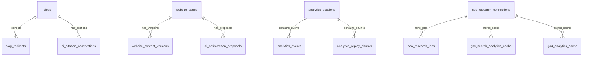

# API, Database & Configuration Reference

**Document Version:** 8.3.0 Baseline Draft  
**Inspected Commit:** `e51b0240be6b8a00e491909013475be062c92f5b`  
**Authoritative Backend Files:** `server/routes/*`, `server/db.ts`, `server/mcpServer.ts`

---

## 1. Complete API Route Inventory

### 1.1 Public & Visitor Endpoints (`server/routes/api.ts` & `server/index.ts`)

| HTTP Method | Route Path | Purpose | Authentication | Input Payload / Query | Output Schema |
| :--- | :--- | :--- | :--- | :--- | :--- |
| `GET` | `/api/health` | Health probe & version check | None | None | `{ status: "ok", brand: "Dawnexus", version: "8.3.0" }` |
| `GET` | `/sitemap.xml` | Dynamic XML sitemap | None | None | `application/xml` (all public routes + published blogs) |
| `GET` | `/robots.txt` | Crawler access rules | None | None | `text/plain` |
| `GET` | `/llms.txt` | AI crawler documentation | None | None | `text/markdown` |
| `GET` | `/llms-full.txt`| Detailed AI documentation | None | None | `text/markdown` |
| `GET` | `/api/blogs` | Public blog list | None | `?category=&page=&limit=` | `{ blogs: BlogRecord[], total: number }` |
| `GET` | `/api/blogs/:slug`| Single published blog by slug | None | None | `BlogRecord` (or 404) |
| `POST` | `/api/enquiries` | Submit contact enquiry | None (Rate limited) | `{ name, email, phone, services, budget, message }` | `{ success: true, id: number }` |
| `GET` | `/api/clients` | Public client portfolio items | None | None | `{ clients: ClientRecord[] }` |
| `GET` | `/api/calculator/config`| Cost calculator pricing tiers | None | None | `CalculatorPricingConfig` |
| `POST` | `/api/calculator/calculate`| Calculate project cost | None | `{ type, pageCount, features, designTier }` | `{ setupTotal, recurringMonthlyTotal, lineItems }` |
| `POST` | `/api/calculator/enquiry` | Submit enquiry from calculator | None (Rate limited) | `{ ...formData, estimateData }` | `{ success: true, id: number, estimate_ref_id }` |
| `GET` | `/api/content/pages/:slug`| Get dynamic service page data | None | None | `ServicePageContent` |
| `POST` | `/api/analytics/collect` | Ingest visitor telemetry event | None (Rate limited) | `{ event_type, path, session_id, metadata }` | `{ success: true }` |
| `POST` | `/api/assistant` | AI website chat assistant | None (Rate limited) | `{ message, history }` | `{ reply: string }` |
| `GET/POST`| `/api/cron/publish` | Automated scheduled publisher | None / Secret | None | `{ publishedCount: number, published: string[] }` |
| `GET/POST`| `/api/cron/db-health` | Scheduled DB health probe | None / Secret | None | `{ status: "healthy", latencyMs: number }` |

---

### 1.2 Administrative Protected Endpoints (`server/routes/admin.ts`)
*All endpoints below require active session cookie (`dawnexus_session`) unless specified.*

| HTTP Method | Route Path | Purpose | Request Body | Output Schema |
| :--- | :--- | :--- | :--- | :--- |
| `POST` | `/api/admin/login` | Admin login | `{ password: string }` | Sets `dawnexus_session` cookie; `{ success: true }` |
| `GET` | `/api/admin/session` | Validate session | None | `{ authenticated: boolean }` |
| `POST` | `/api/admin/logout` | Terminate session | None | Clears cookie; `{ success: true }` |
| `GET` | `/api/admin/stats` | Dashboard metric counts | None | `{ enquiries, unread, blogs, clients }` |
| `GET` | `/api/admin/blogs` | Complete blog inventory | `?search=&status=&page=` | `{ blogs: BlogRecord[], total: number }` |
| `GET` | `/api/admin/blogs/:id` | Get full blog record by ID | None | `BlogRecord` |
| `POST` | `/api/admin/blogs` | Create new article | `BlogInput` | `{ success: true, blog: BlogRecord }` |
| `PATCH`| `/api/admin/blogs/:id` | Update / publish article | `Partial<BlogInput>` | `{ success: true, blog: BlogRecord }` |
| `DELETE`| `/api/admin/blogs/:id` | Delete article | None | `{ success: true }` |
| `POST` | `/api/admin/blogs/:id/duplicate`| Clone article as draft | None | `{ success: true, duplicatedId: number }` |
| `POST` | `/api/admin/blogs/upload-image`| Upload article image | `multipart/form-data` | `{ url: string, alt: string }` |
| `GET` | `/api/admin/enquiries` | List customer enquiries | `?status=&search=&page=` | `{ enquiries: EnquiryRecord[], total: number }` |
| `GET` | `/api/admin/enquiries/:id`| Full enquiry details | None | `EnquiryRecord` |
| `PATCH`| `/api/admin/enquiries/:id`| Update status or notes | `{ status?, admin_notes? }`| `{ success: true }` |
| `DELETE`| `/api/admin/enquiries/:id`| Permanently delete enquiry | None | `{ success: true }` |
| `GET` | `/api/admin/export` | Download CSV of enquiries | None | `text/csv` |
| `GET` | `/api/admin/notification-settings`| Get notification config | None | `NotificationSettings` |
| `POST` | `/api/admin/notification-settings/request-otp`| Dispatch OTP to email | `{ email: string }` | `{ success: true, challengeId: string }` |
| `POST` | `/api/admin/notification-settings/verify-otp`| Verify OTP challenge | `{ challengeId, otp }` | `{ success: true, verified: true }` |
| `POST` | `/api/admin/notification-settings/deactivate`| Disable notifications | None | `{ success: true }` |
| `GET` | `/api/admin/db-health` | Telemetry & connection stats | None | `{ status, engine, latencyMs, tableCounts }` |
| `POST` | `/api/admin/db-health/check` | Trigger real-time DB audit | None | Complete health diagnostic object |
| `GET` | `/api/admin/calculator/config`| Get calculator rules | None | `CalculatorPricingConfig` |
| `PUT` | `/api/admin/calculator/config`| Update calculator rules | `CalculatorPricingConfig` | `{ success: true }` |
| `GET` | `/api/admin/content/pages` | List editable service pages | None | `{ pages: ServicePageSummary[] }` |
| `GET` | `/api/admin/content/pages/:slug`| Get service page data | None | `ServicePageContent` |
| `POST` | `/api/admin/content/pages/:slug/draft`| Save optimization draft | `{ content }` | `{ success: true, draftId: number }` |
| `POST` | `/api/admin/content/pages/:slug/publish`| Publish live changes | `{ content }` | `{ success: true, versionNumber: number }` |
| `GET` | `/api/admin/content/pages/:slug/versions`| Revision history | None | `{ versions: ContentVersionRecord[] }` |
| `POST` | `/api/admin/content/pages/:slug/rollback`| Rollback to version | `{ versionId: number }` | `{ success: true }` |
| `GET` | `/api/admin/diagnostics` | System-wide diagnostics | None | Diagnostic status object |
| `GET` | `/api/admin/seo-quality/audit/:id`| Run Information Gain audit | None | `InformationGainReport` |
| `GET` | `/api/admin/seo-quality/freshness`| Get content freshness list | None | `{ articles: FreshnessArticle[] }` |
| `POST` | `/api/admin/seo-quality/freshness/:id/review`| Mark article reviewed | None | `{ success: true }` |
| `GET` | `/api/admin/seo-quality/payload-audit`| HTML payload size report | None | `{ routes: RoutePayloadAudit[] }` |
| `GET` | `/api/admin/seo-quality/citations`| List AI citation logs | None | `{ citations: AiCitationObservation[] }` |
| `POST` | `/api/admin/seo-quality/citations`| Record AI citation | `{ blog_id, ai_platform, query, citation_snippet }` | `{ success: true, id: number }` |
| `DELETE`| `/api/admin/seo-quality/citations/:id`| Delete citation log | None | `{ success: true }` |
| `GET` | `/api/admin/seo-quality/ctas` | Get contextual CTA configs | None | `{ ctas: ContextualCtaConfig[] }` |
| `PUT` | `/api/admin/seo-quality/ctas` | Update CTA configs | `{ ctas: ContextualCtaConfig[] }` | `{ success: true }` |

---

### 1.3 Google Integration Endpoints (`/api/admin/seo-research` & `/api/admin/analytics`)

| HTTP Method | Route Path | Purpose | Authentication |
| :--- | :--- | :--- | :--- |
| `GET` | `/api/admin/seo-research/status` | GSC OAuth status & selected property | Admin Session |
| `GET` | `/api/admin/seo-research/google/auth-url` | Generate Google OAuth consent URL | Admin Session |
| `GET` | `/api/admin/seo-research/google/callback` | Google OAuth redirect callback | Public (Google redirect) |
| `POST` | `/api/admin/seo-research/disconnect` | Disconnect Google integration | Admin Session |
| `GET` | `/api/admin/seo-research/properties` | List verified GSC site properties | Admin Session |
| `POST` | `/api/admin/seo-research/select-property` | Set active GSC site property | Admin Session |
| `GET` | `/api/admin/seo-research/timeline` | Query daily clicks/impressions | Admin Session |
| `GET` | `/api/admin/seo-research/query-comparison`| Query ranking comparisons | Admin Session |
| `GET` | `/api/admin/seo-research/top-pages` | Top pages by organic clicks | Admin Session |
| `POST` | `/api/admin/seo-research/sync` | Trigger background GSC sync job | Admin Session |
| `POST` | `/api/admin/seo-research/opportunities` | Evaluate low CTR search queries | Admin Session |
| `POST` | `/api/admin/seo-research/generate-prompt`| Generate content creation brief | Admin Session |
| `GET` | `/api/admin/analytics/status` | GA4 OAuth connection status | Admin Session |
| `GET` | `/api/admin/analytics/properties` | List accessible GA4 properties | Admin Session |
| `POST` | `/api/admin/analytics/select-property`| Set active GA4 property | Admin Session |
| `GET` | `/api/admin/analytics/overview` | GA4 Active users, sessions, conversions | Admin Session |
| `GET` | `/api/admin/analytics/traffic-acquisition`| Channel groupings and traffic sources | Admin Session |
| `GET` | `/api/admin/analytics/landing-pages` | Top entry pages & bounce rate | Admin Session |
| `GET` | `/api/admin/analytics/realtime` | Active users in preceding 30 minutes | Admin Session |
| `POST` | `/api/admin/analytics/sync` | Force live GA4 sync | Admin Session |

---

### 1.4 Model Context Protocol Endpoints

| HTTP Method | Route Path | Purpose | Authentication |
| :--- | :--- | :--- | :--- |
| `GET/POST/DELETE`| `/mcp` | Streamable HTTP (SSE) MCP Transport for Claude | Bearer token or `x-mcp-api-key` |
| `POST` | `/api/mcp/rpc` | JSON-RPC 2.0 tool execution endpoint | Bearer token or `x-mcp-api-key` |
| `POST` | `/api/mcp/tools/call`| OpenAPI REST bridge for ChatGPT Actions | Bearer token or `x-mcp-api-key` |
| `GET` | `/api/mcp/openapi.json`| OpenAPI 3.1 schema specification | Public (read-only) |
| `GET` | `/oauth/authorize` | RFC 7636 OAuth PKCE Authorization endpoint | Admin Session / PKCE params |
| `POST` | `/oauth/token` | RFC 7636 OAuth Token exchange endpoint | Client authentication & code verifier |
| `GET` | `/.well-known/oauth-authorization-server` | RFC 8414 OAuth server metadata | Public (read-only) |
| `GET` | `/.well-known/oauth-protected-resource` | RFC 9728 Protected resource metadata | Public (read-only) |

---

## 2. Complete Database Schema (27 Tables)

1. **`enquiries`**: Contact form and calculator leads (`id`, `name`, `email`, `phone`, `services`, `budget`, `message`, `status`, `admin_notes`, `idempotency_key`, `estimate_ref_id`, `estimate_data`, `created_at`, `updated_at`).
2. **`admin_sessions`**: Active administrator login sessions (`token` PK, `created_at`, `expires_at`).
3. **`blogs`**: Primary content management articles inventory (`id` PK, `title`, `slug` UNIQUE, `content`, `excerpt`, `featured_image`, `image_alt`, `author`, `category`, `tags`, `primary_keyword`, `secondary_keywords`, `target_location`, `search_intent`, `seo_title`, `meta_description`, `canonical_url`, `status`, `scheduled_at`, `published_at`, `last_reviewed_at`, `reading_time`, `firsthand_observations`, `project_examples`, `case_studies`, `original_research_data`, `source_citations`, `citation_answer_blocks`, `seo_report`, `content_revision`, `created_at`, `updated_at`).
4. **`blog_redirects`**: URL redirect mapping for modified slugs (`id`, `old_slug` UNIQUE, `new_slug`, `created_at`).
5. **`notification_settings`**: Alert recipients for incoming leads (`id`, `email`, `is_active`, `updated_at`).
6. **`notification_otp_challenges`**: Verification challenges for changing notification recipients (`id`, `email`, `otp_hash`, `attempts`, `expires_at`, `created_at`).
7. **`seo_research_connections`**: Encrypted OAuth credentials for GSC & GA4 (`id`, `property_id`, `site_url`, `selected_property_id`, `access_token`, `refresh_token`, `token_expires_at`, `is_connected`, `account_email`, `updated_at`).
8. **`seo_research_jobs`**: Background Search Console synchronization job tracking (`id`, `job_type`, `status`, `error_message`, `created_at`, `completed_at`).
9. **`gsc_search_analytics_cache`**: Cached Search Console dimensional performance metrics (`id`, `property_id`, `dimension_type`, `date_key`, `query`, `page`, `clicks`, `impressions`, `ctr`, `position`, `created_at`).
10. **`ga4_analytics_jobs`**: Background GA4 telemetry sync jobs (`id`, `job_type`, `status`, `created_at`, `completed_at`).
11. **`ga4_analytics_cache`**: Cached GA4 metrics (`id`, `property_id`, `report_type`, `date_range`, `data_json`, `created_at`).
12. **`oauth_states`**: Anti-CSRF OAuth verification challenges (`state` PK, `created_at`, `expires_at`).
13. **`clients`**: Public client showcase portfolio (`id` PK, `name`, `industry`, `logo_url`, `featured_image`, `case_study_url`, `display_order`, `is_active`, `created_at`).
14. **`ai_citation_observations`**: Recorded citations in AI search models (`id` PK, `blog_id`, `ai_platform`, `query`, `citation_snippet`, `observed_at`).
15. **`contextual_cta_configs`**: In-article dynamic call-to-action blocks (`id` PK, `service_key`, `headline`, `subtext`, `button_text`, `target_url`, `is_active`).
16. **`calculator_pricing_config`**: Pricing logic and line items for the Website Cost Calculator (`id` PK, `config_json`, `updated_at`).
17. **`website_pages`**: Active copy for service landing pages (`slug` PK, `title`, `hero_subtitle`, `hero_description`, `hero_primary_cta`, `capabilities`, `process_steps`, `pricing_packages`, `faqs`, `cta_section`, `meta_title`, `meta_description`, `updated_at`).
18. **`website_content_versions`**: Historical revisions for service pages (`id` PK, `page_slug`, `version_number`, `content_json`, `created_by`, `change_summary`, `created_at`).
19. **`ai_optimization_proposals`**: AI/staff content change proposals (`id` PK, `page_slug`, `proposal_json`, `status`, `created_at`).
20. **`optimization_experiments`**: A/B testing experiment definitions (`id` PK, `page_slug`, `variant_json`, `status`, `created_at`).
21. **`analytics_sessions`**: First-party visitor sessions (`session_id` PK, `ip_hash`, `user_agent`, `country`, `device`, `entry_path`, `exit_path`, `duration_seconds`, `is_bot`, `created_at`).
22. **`analytics_events`**: Granular behavioural interaction events (`id` PK, `session_id`, `event_type`, `path`, `target_element`, `scroll_depth`, `metadata_json`, `created_at`).
23. **`analytics_replay_chunks`**: Aggregated mouse and scroll replay chunks (`id` PK, `session_id`, `chunk_data`, `created_at`).
24. **`analytics_aggregates`**: Pre-aggregated hourly/daily behavioural rollups (`id` PK, `metric_key`, `date_key`, `metric_value`).
25. **`admin_audit_logs`**: Operational history of administrative actions (`id` PK, `user`, `action`, `entity_type`, `entity_id`, `details`, `created_at`).
26. **`seo_categories`**: Content taxonomy table (`id` PK, `name`, `slug` UNIQUE, `description`).
27. **`gemini_usage_logs`**: Token usage telemetry for Google Gemini AI calls (`id` PK, `model`, `prompt_tokens`, `candidates_tokens`, `created_at`).

---

## 3. Environment Configuration Reference

| Environment Variable | Purpose | Classification | Where Configured |
| :--- | :--- | :--- | :--- |
| `ADMIN_PASSWORD` | Master password for `/admin` authentication (defaults to dev fallback `9566`). | **Secret** | Vercel Environment / `.env` |
| `MCP_API_KEY` | Secret token used to authenticate AI models connecting to `/mcp` or `/api/mcp/rpc`. | **Secret** | Vercel Environment / `.env` |
| `ENCRYPTION_KEY` | AES-256-GCM encryption key used to encrypt Google OAuth tokens in the database. | **Secret** | Vercel Environment / `.env` |
| `SUPABASE_URL` | Cloud Supabase project endpoint (e.g. `https://xxxx.supabase.co`). | **Configuration** | Vercel Environment / `.env` |
| `SUPABASE_SERVICE_ROLE_KEY` | Service role key granting server-side access to Supabase PostgreSQL. | **Secret** | Vercel Environment / `.env` |
| `GOOGLE_CLIENT_ID` | OAuth 2.0 client ID for Google Search Console and GA4 authorization. | **Configuration** | Vercel Environment / `.env` |
| `GOOGLE_CLIENT_SECRET` | OAuth 2.0 client secret for Google Search Console and GA4 authorization. | **Secret** | Vercel Environment / `.env` |
| `GOOGLE_REDIRECT_URI` | Whitelisted OAuth redirect URL (e.g. `https://www.dawnexus.in/api/admin/seo-research/google/callback`). | **Configuration** | Vercel Environment / `.env` |
| `RESEND_API_KEY` | API key for Resend transactional email delivery. | **Secret** | Vercel Environment / `.env` |
| `SMTP_HOST` | Hostname for custom SMTP mail server (alternative to Resend). | **Configuration** | Vercel Environment / `.env` |
| `SMTP_PORT` | Port for custom SMTP mail server (typically 587 or 465). | **Configuration** | Vercel Environment / `.env` |
| `SMTP_USER` | Username for custom SMTP mail server. | **Secret** | Vercel Environment / `.env` |
| `SMTP_PASS` | Password for custom SMTP mail server. | **Secret** | Vercel Environment / `.env` |
| `GEMINI_API_KEY` | Google Gemini API key used by `server/geminiService.ts`. | **Secret** | Vercel Environment / `.env` |
| `NODE_ENV` | Application environment flag (`production`, `development`, or `test`). | **Configuration** | Vercel Environment / `.env` |

