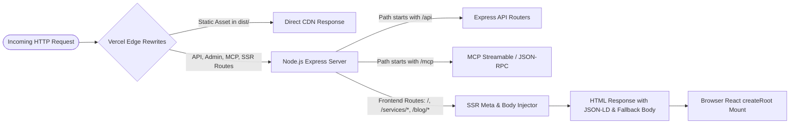
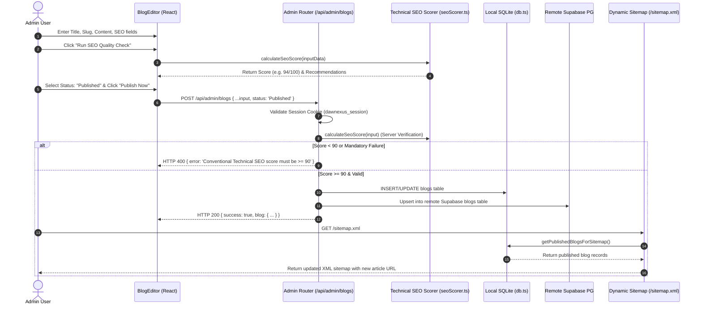
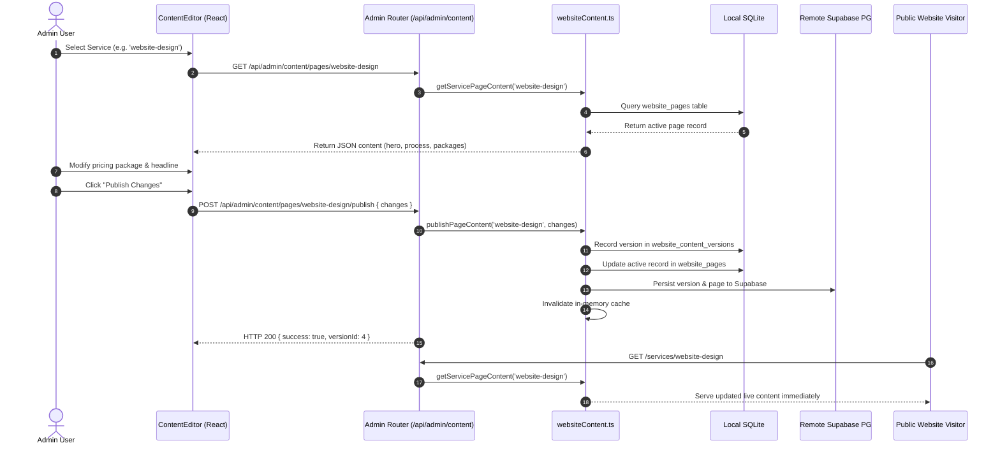
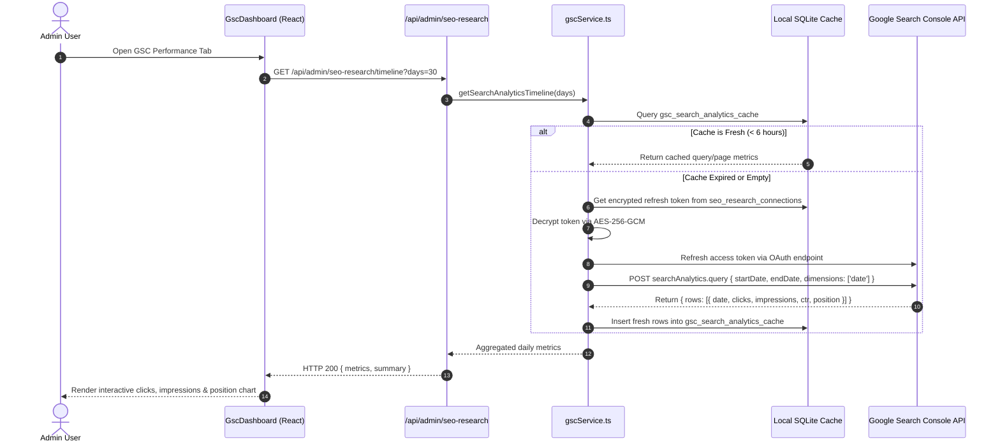
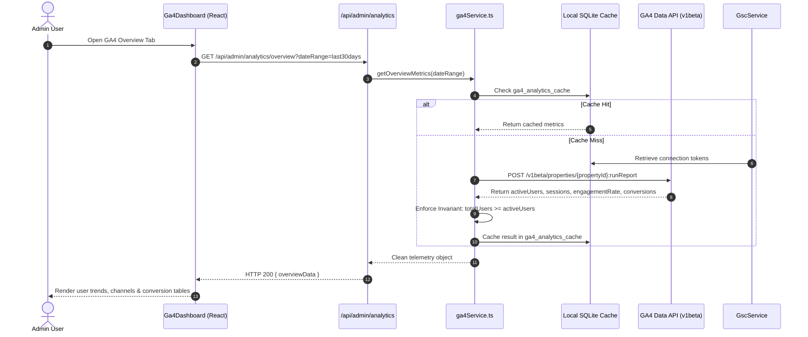
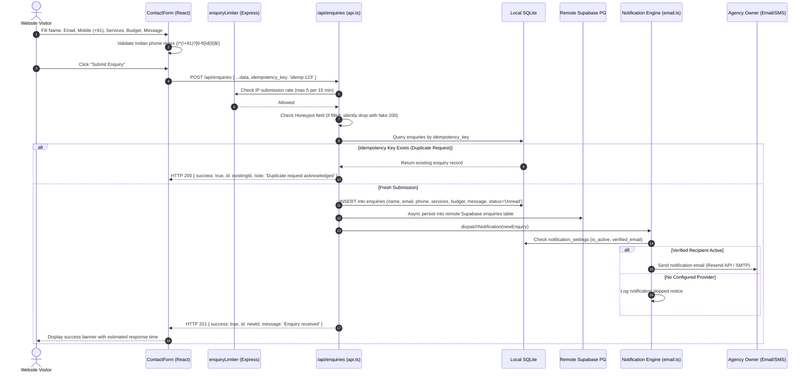
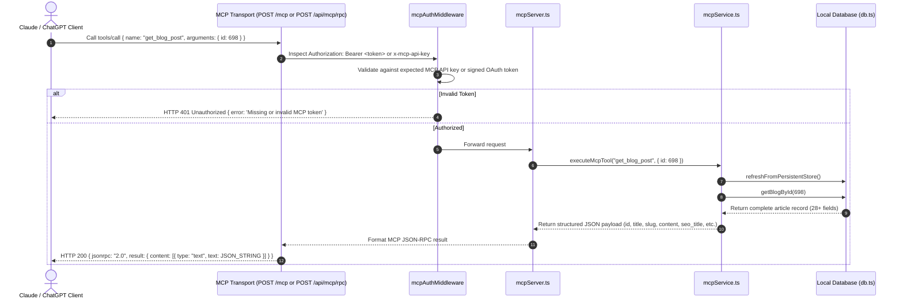
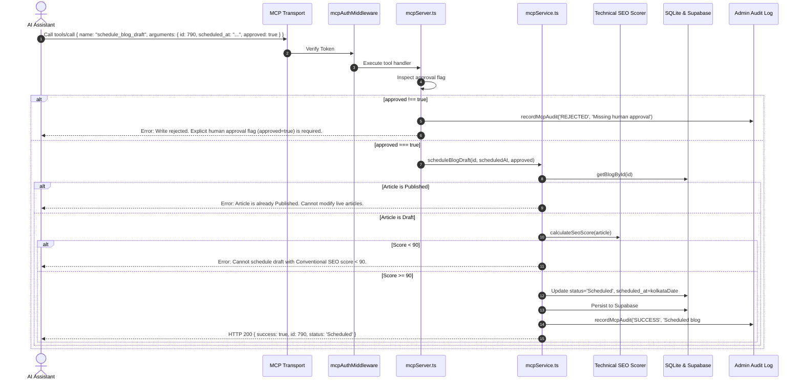
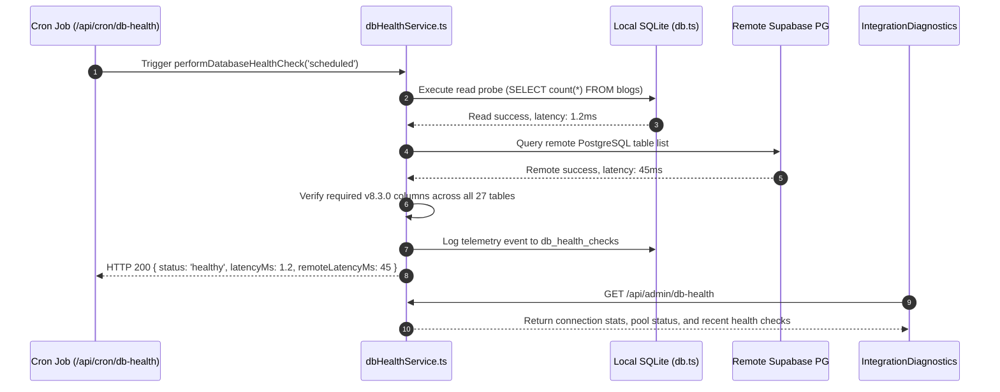

# Architecture and End-to-End Data Flow

**Document Version:** 8.3.0 Baseline Draft  
**Inspected Commit:** `e51b0240be6b8a00e491909013475be062c92f5b`  
**Authoritative Entry Points:** `server/index.ts`, `api/index.ts`, `src/App.tsx`

---

## 1. Request Lifecycle & Routing Architecture

Dawnexus uses a unified routing and rendering pipeline designed for both search crawler indexability and single-page application interactivity:



### 1.1 Vercel Edge Rewrites (`vercel.json`)
- Static assets located in `dist/assets/`, `dist/brand/`, or root static files (`robots.txt`, `llms.txt`, `site.webmanifest`) are served directly from the edge cache with immutable `Cache-Control: public, max-age=31536000, immutable` headers.
- Route prefixes `/.well-known/*`, `/sitemap.xml`, `/api/*`, `/mcp`, `/mcp/*`, `/oauth/*`, `/services/*`, `/blog`, `/blog/*`, and `/website-cost-calculator` are rewritten to `/api/index.ts` (the Node.js Serverless Function).
- Catch-all fallback rewrites unmatched paths to `/index.html`.

### 1.2 SSR Metadata & Fallback HTML Injection (`server/ssrRenderer.ts`)
When a request reaches `handlePageHtmlRequest` in `server/index.ts`:
1. The server loads the base HTML template (`dist/index.html` or `index.html`).
2. `resolvePageMetadata(pathname)` resolves route-specific metadata:
   - Homepage (`/`): Organization & WebSite schema, descriptive title, meta description.
   - Service landing pages (`/services/:slug`): Service title, description, single `<h1>`, breadcrumbs, and `Service` JSON-LD schema with `Organization` provider.
   - Cost Calculator (`/website-cost-calculator`): SoftwareApplication schema, single `<h1>`, estimation copy.
   - Blog hub (`/blog`): Blog schema, single `<h1>`, list of latest published articles.
   - Blog post (`/blog/:slug`): Author, published dates, reading time, excerpt, sanitized article body, and Schema.org `BlogPosting` JSON-LD.
3. `injectPageMetadata(html, meta)`:
   - Replaces `<title>`, `<meta name="description">`, `<link rel="canonical">`, Open Graph, and Twitter tags.
   - Replaces `<script id="page-json-ld">` cleanly without duplicate tags.
   - Injects the semantic fallback HTML into `<div id="root">...</div>`.
4. The server returns HTTP 200 (or HTTP 404 for unknown blog slugs) with `Cache-Control: public, max-age=0, must-revalidate`.

### 1.3 Client-Side React Hydration (`src/main.tsx` & `src/App.tsx`)
1. The browser parses the initial HTML response, displaying the fallback layout immediately with zero layout shift.
2. `src/main.tsx` executes:
   ```typescript
   ReactDOM.createRoot(document.getElementById('root')!).render(<App />);
   ```
3. `createRoot` clears the children of `#root` and renders the dynamic React component tree.
4. `src/utils/navigation.ts` dispatches custom navigation events, updating the URL via `window.history.pushState` and dynamically switching views without full-page reloads.

---

## 2. Core End-to-End Sequence Diagrams

### 2.1 Workflow 1: Create and Publish a Blog Post



---

### 2.2 Workflow 2: Update a Service Page via Web Content Manager



---

### 2.3 Workflow 3: Retrieve Google Search Console Performance Data



---

### 2.4 Workflow 4: Retrieve Google Analytics 4 Performance Data



---

### 2.5 Workflow 5: Public Visitor Submits an Enquiry



---

### 2.6 Workflow 6: AI Client Executes an MCP Read-Only Tool



---

### 2.7 Workflow 7: AI Client Executes an Authorized MCP Write Operation



---

### 2.8 Workflow 8: Database Health Check & Synchronization Cycle



