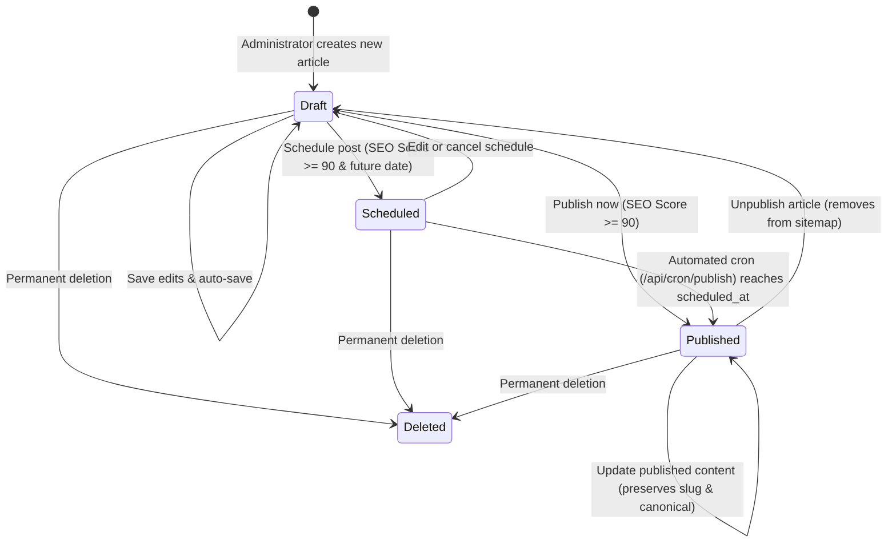

# Blog CMS & Publishing Engine

**Document Version:** 8.3.0 Baseline Draft  
**Inspected Commit:** `e51b0240be6b8a00e491909013475be062c92f5b`  
**Authoritative Backend Files:** `server/db.ts`, `server/routes/admin.ts`, `server/seoQualityService.ts`, `server/seoScorer.ts`, `server/ssrRenderer.ts`  
**Authoritative Frontend Components:** `src/components/admin/BlogManager.tsx`, `src/components/admin/BlogEditor.tsx`, `src/components/admin/BlogList.tsx`, `src/components/admin/BlogCalendar.tsx`

---

## 1. Overview & Data Model

The Dawnexus Blog CMS manages the lifecycle of articles from initial drafting and technical SEO validation to scheduled automated publication and public crawlability.

### 1.1 Database Schema (`blogs` table in SQLite & Supabase PostgreSQL)

| Column Name | Data Type | Default / Nullability | Description |
| :--- | :--- | :--- | :--- |
| `id` | `INTEGER` | `PRIMARY KEY AUTOINCREMENT` | Unique article identifier. |
| `title` | `TEXT` | `NOT NULL` | Editorial title of the article. |
| `slug` | `TEXT` | `NOT NULL UNIQUE` | URL-safe slug (used in `/blog/:slug`). |
| `excerpt` | `TEXT` | `NULL` | Short summary for cards and meta snippets. |
| `content` | `TEXT` | `NOT NULL` | Full article body stored as sanitized HTML. |
| `featured_image` | `TEXT` | `NULL` | URL of the hero image (local or CDN). |
| `image_alt` | `TEXT` | `NULL` | Accessible alt text for the featured image. |
| `author` | `TEXT` | `'Dawnexus Editorial'` | Author name. |
| `author_role` | `TEXT` | `NULL` | Author title (e.g. Technical Architect). |
| `author_bio` | `TEXT` | `NULL` | Author biography snippet. |
| `author_credentials`| `TEXT` | `NULL` | Formal credentials or certifications. |
| `reviewer_name` | `TEXT` | `NULL` | Technical/editorial reviewer name. |
| `reviewer_credentials`| `TEXT`| `NULL` | Technical reviewer credentials. |
| `category` | `TEXT` | `NOT NULL` | One of the 7 approved CMS categories. |
| `tags` | `TEXT` | `NULL` | Comma-separated or JSON array of tags. |
| `primary_keyword` | `TEXT` | `NULL` | Target organic search phrase. |
| `secondary_keywords`| `TEXT` | `NULL` | Comma-separated supporting keywords. |
| `target_location` | `TEXT` | `NULL` | Geographic relevance (e.g. Coimbatore, India). |
| `search_intent` | `TEXT` | `'Informational'` | Informational, Commercial, Transactional, Navigational. |
| `target_audience` | `TEXT` | `NULL` | Intended reader profile. |
| `target_questions` | `TEXT` | `NULL` | Target questions addressed by the piece. |
| `seo_title` | `TEXT` | `NULL` | Custom SERP `<title>` tag content. |
| `meta_description`| `TEXT` | `NULL` | Custom `<meta name="description">` snippet. |
| `canonical_url` | `TEXT` | `NULL` | Authoritative canonical URL. |
| `status` | `TEXT` | `'Draft'` | `'Draft'`, `'Scheduled'`, `'Published'`, `'Failed'`. |
| `scheduled_at` | `TEXT` | `NULL` | ISO timestamp for publication. |
| `published_at` | `TEXT` | `NULL` | ISO timestamp of live release. |
| `last_reviewed_at` | `TEXT` | `NULL` | ISO timestamp of last factual review. |
| `reading_time` | `TEXT` | `'5 min read'` | Calculated reading duration. |
| `firsthand_observations` | `TEXT` | `NULL` | Practitioner observations. |
| `project_examples`| `TEXT` | `NULL` | Concrete deployment examples. |
| `case_studies` | `TEXT` | `NULL` | Real client outcome narratives. |
| `original_research_data` | `TEXT` | `NULL` | Proprietary data points or metrics. |
| `source_citations` | `TEXT` | `NULL` | JSON array of external references. |
| `citation_answer_blocks` | `TEXT` | `NULL` | JSON array of Q&A answer blocks. |
| `seo_report` | `TEXT` | `NULL` | Persisted technical SEO quality audit. |
| `created_at` | `TEXT` | `CURRENT_TIMESTAMP` | Initial creation time. |
| `updated_at` | `TEXT` | `CURRENT_TIMESTAMP` | Last modification time. |

---

## 2. Blog Creation, Editor & Representation

### 2.1 Editor Workspace (`src/components/admin/BlogEditor.tsx`)
Administrators navigate to `/admin?tab=blogs` and click **"New Post"** or select an existing post from the table or calendar. The editor provides 6 tabs:
1. **Content Tab:** Title, custom slug input (with auto-kebab generation), excerpt, image upload/URL with alt text, category dropdown, tags, and a rich HTML editor textarea with formatting tools (H2, H3, Bold, Italic, Link, Lists, Blockquote, Code, Word counter).
2. **Evidence & E-E-A-T Tab:** Firsthand observations, project examples, real-world case studies, original research data points, external source citations (URL, domain, title, key takeaway), and author/reviewer credentials.
3. **Citation Answer Blocks Tab:** Structured direct Q&A blocks designed for concise answers (target 40–60 words) with heading level assignment (H2/H3/H4) and intent targeting.
4. **SEO Tab:** SERP title preview, meta description counter (with optimal 140–160 char guidance), canonical URL, primary keyword, secondary keywords, target location, and real-time conventional SEO score calculation.
5. **Intent Tab:** Primary search intent, audience classification, and question targeting.
6. **Schedule Tab:** Article publication status selector (`Draft`, `Scheduled`, `Published`), date/time picker (using Asia/Kolkata timezone), and action buttons.

### 2.2 Content Body Format
The content body is stored as **clean, sanitized HTML** in the SQLite and Supabase PostgreSQL `content` column. When saved, client-side DOMPurify (`isomorphic-dompurify`) strips disallowed script tags and malicious attributes before submission to `PATCH /api/admin/blogs/:id` or `POST /api/admin/blogs`.

---

## 3. Evidence, E-E-A-T & Citation Answer Blocks

To satisfy the 8 documentation requirements for each feature:

### 3.1 Firsthand Observations, Project Examples & Case Studies
1. **Where entered:** `BlogEditor.tsx` under the **Evidence** tab.
2. **Where stored:** Columns `firsthand_observations`, `project_examples`, and `case_studies` in the `blogs` table.
3. **Frontend display:** Rendered in `BlogPostPage.tsx` under dedicated evidence callout boxes with visual badges.
4. **Backend processing:** Inspected by `assessInformationGain()` in `server/seoQualityService.ts` to compute evidence density.
5. **AI role:** Evaluated heuristically by backend scoring; can be drafted via AI assistance, but content is manual or human-approved.
6. **Validation:** Assessed for minimum length; checked during Information Gain audit.
7. **Public availability:** Rendered on public blog pages when populated.
8. **Manual workflow:** Entry and factual verification remain fully manual.

### 3.2 Source Citations
1. **Where entered:** `BlogEditor.tsx` Citation Manager under the **Evidence** tab.
2. **Where stored:** JSON string in `source_citations` column (`[{ title, url, domain, key_takeaway }]`).
3. **Frontend display:** Displayed as a footnote references section at the bottom of `BlogPostPage.tsx`.
4. **Backend processing:** Parsed by `seoQualityService.ts` to ensure non-hallucinatory, domain-verified external references.
5. **AI role:** Backend checks external citation counts; no automated fabrication of URLs is permitted.
6. **Validation:** Checks for valid HTTP/HTTPS URL syntax and domain presence.
7. **Public availability:** Rendered publicly with `rel="noopener noreferrer"`.
8. **Manual workflow:** Source selection and URL input are manual.

### 3.3 Author & Reviewer Credentials
1. **Where entered:** `BlogEditor.tsx` under the **Evidence** tab.
2. **Where stored:** Columns `author`, `author_role`, `author_bio`, `author_credentials`, `reviewer_name`, `reviewer_credentials`, `last_reviewed_at`.
3. **Frontend display:** Rendered in the author box of `BlogPostPage.tsx` and injected into Schema.org `author` (`Person` entity) and `hasCredential`.
4. **Backend processing:** Formatted by `JsonLdService.generateArticleSchema()`.
5. **AI role:** Strictly prohibited from inventing credentials.
6. **Validation:** Verified during JSON-LD validation (`validateJsonLdStructure`).
7. **Public availability:** Rendered visibly on the page and in the raw HTML JSON-LD script.
8. **Manual workflow:** Author and reviewer assignment are manual.

### 3.4 Citation Answer Blocks
1. **Where entered:** `BlogEditor.tsx` under the **Citation Blocks** tab.
2. **Where stored:** JSON string in `citation_answer_blocks` column (`[{ id, question, answer, heading_level, target_intent, word_count }]`).
3. **Frontend display:** Rendered via `<CitationAnswerBlock />` (`src/components/public/CitationAnswerBlock.tsx`) as highlighted Q&A callouts in `BlogPostPage.tsx`.
4. **Backend processing:** Counted and evaluated by `seoQualityService.ts`.
5. **AI role:** Suggests optimal answer word counts (40–60 words) to target snippet features.
6. **Validation:** Heading levels restricted to `h2`, `h3`, or `h4`; answer length evaluated; duplicate question text prevented.
7. **Public availability:** Included directly in the raw HTML body during SSR for crawler visibility.
8. **Manual workflow:** Question definition and answer formulation are human-authored or human-reviewed.

---

## 4. Conventional Technical SEO vs. Information Gain Gating

### 4.1 Conventional Technical SEO (The Single Automated Publication Gate)
In accordance with production rules restored in Version 8.3.0, **Conventional Technical SEO is the ONLY automated requirement for approving and publishing articles.**

To achieve approval and publish/schedule:
- **Minimum Score:** $90 / 100$ computed by `calculateSeoScore()` in `server/seoScorer.ts`.
- **Mandatory Criteria (Zero Failure Allowance):**
  1. Title length between 25 and 70 characters.
  2. Slug is valid URL-kebab format.
  3. Meta description length between 120 and 160 characters.
  4. Content body word count $\ge 800$ words.
  5. Primary keyword defined and present in title, meta description, and content.
  6. Exactly one `<h1>` tag in the rendered page.
  7. Internal links point exclusively to valid Dawnexus URLs (`https://www.dawnexus.in/...`) or published blog slugs with zero broken links.
  8. Canonical URL matches authoritative HTTPS www format.

### 4.2 Information Gain & E-E-A-T (Informational Audit Only)
The separate Information Gain & Content Quality audit (`server/seoQualityService.ts` and `AdvancedSeoDashboard.tsx`):
- Measures original research data, firsthand observations, case studies, and citation answer blocks.
- **Does NOT block or gate blog publication.** It operates strictly as an informational audit tool to guide editorial depth.

---

## 5. Content State Machine & Lifecycle Transitions

### 5.1 Publishing State Behaviors

| Action | API Route | State Change | Sitemap & Crawler Impact |
| :--- | :--- | :--- | :--- |
| **Save Draft** | `POST /api/admin/blogs` or `PATCH /api/admin/blogs/:id` | `status = 'Draft'` | Excluded from `/sitemap.xml`; SSR returns 404 for non-admin visitors. |
| **Schedule Article** | `PATCH /api/admin/blogs/:id` | `status = 'Scheduled'`, `scheduled_at = ISO_TIMESTAMP` | Excluded from `/sitemap.xml`; scheduled time converted to Asia/Kolkata. |
| **Publish Live** | `PATCH /api/admin/blogs/:id` | `status = 'Published'`, `published_at = ISO_TIMESTAMP` | Immediately included in dynamic `/sitemap.xml`; live on `/blog/:slug`. |
| **Unpublish** | `PATCH /api/admin/blogs/:id` | `status = 'Draft'` | Instantly removed from `/sitemap.xml`; public route returns 404. |
| **Delete** | `DELETE /api/admin/blogs/:id` | Record deleted from `blogs` | Permanent removal; redirect can be configured in `blog_redirects`. |

### 5.2 Automated Publishing Cron (`/api/cron/publish`)
Vercel executes a daily cron job (or server-side 60-second polling interval):
1. Calls `publishDueScheduledBlogsReliable()` in `server/db.ts`.
2. Queries SQLite for articles where `status = 'Scheduled'` and `datetime(scheduled_at) <= datetime('now')`.
3. Sets `status = 'Published'`, updates `published_at = CURRENT_TIMESTAMP`, and syncs to Supabase PostgreSQL.
4. Auto-published articles immediately become indexable in `/sitemap.xml`.

