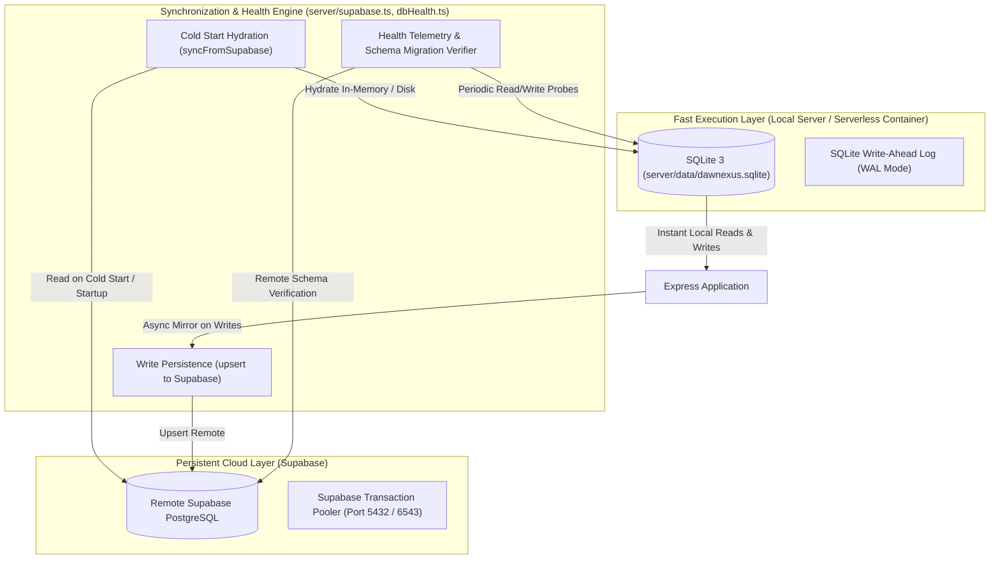

# Database Health, Synchronization & Maintenance

**Document Version:** 8.3.0 Baseline Draft  
**Inspected Commit:** `e51b0240be6b8a00e491909013475be062c92f5b`  
**Authoritative Backend Files:** `server/db.ts`, `server/supabase.ts`, `server/dbHealth.ts`, `server/routes/admin.ts`  
**Authoritative Frontend Component:** `src/components/admin/DatabaseHealthDashboard.tsx`

---

## 1. Dual-Database Topology & Rationale

Dawnexus operates a dual-layer database topology designed for both zero-latency serverless execution and cloud persistence:

### 1.1 Local SQLite 3 (`server/data/dawnexus.sqlite`)
- Handled via `better-sqlite3`.
- Initialized with **Write-Ahead Logging** (`PRAGMA journal_mode = WAL`) and `PRAGMA synchronous = NORMAL` for high concurrency.
- Primary operational engine during live server runtime, guaranteeing $< 2\text{ms}$ query latency without network overhead.

### 1.2 Remote Supabase PostgreSQL
- Configured via `SUPABASE_URL` and `SUPABASE_SERVICE_ROLE_KEY`.
- Authoritative persistent store for serverless restarts, cloud migrations, and historical disaster recovery.

---

## 2. Startup Hydration & Data Synchronization

When the server starts or cold-starts in Vercel (`api/index.ts` / `server/index.ts`):
1. `initDatabase()` ensures local SQLite tables exist with strict primary and foreign keys.
2. If `SUPABASE_URL` and `SUPABASE_SERVICE_ROLE_KEY` are present:
   - `syncFromSupabase(db)` executes inside a single transaction (`db.exec('BEGIN')`).
   - Hydrates `blogs`, `clients`, `notification_settings`, `enquiries`, `calculator_pricing_config`, `seo_research_connections`, and `website_pages`.
   - Commits the transaction, bringing local SQLite to parity with remote PostgreSQL.
3. If Supabase is unreachable or unconfigured:
   - Logs a warning notice and continues operating from local SQLite without halting server boot.

---

## 3. Database Health Telemetry & Verification

### 3.1 Health Check Engine (`server/db.ts:performDatabaseHealthCheck`)
The health engine executes a multi-point verification:
1. **Local Read Probe:** Queries `SELECT count(*) FROM blogs`.
2. **Local Write Probe:** Inserts and updates an operational telemetry record in `db_health_checks`.
3. **Remote Connectivity Probe:** Verifies active Supabase client connection.
4. **Schema & Migration Verification:** Inspects all 27 tables to ensure mandatory Version 8.3.0 columns exist (e.g. `seo_report`, `content_revision`, `last_reviewed_at`, `source_citations`).
5. **Latency Tracking:** Measures round-trip time in milliseconds for local SQLite and remote PostgreSQL.

### 3.2 Scheduled Recurring Execution
- **In-Process Timer:** Initial check executed at startup, followed by a background interval check every **4 hours** (`setInterval` with `.unref()`).
- **External Cron Endpoint:** Scheduled via Vercel Cron (`vercel.json`) at `30 2 * * *` (02:30 UTC daily) hitting `GET /api/cron/db-health`.

---

## 4. Administrative Health Dashboard (`/admin?tab=db-health`)

The `DatabaseHealthDashboard` component displays:
- **Engine Status:** `ONLINE (SQLite WAL + Remote Supabase Connected)`.
- **Latency Telemetry:** Sub-5ms SQLite read/write latency; ~50ms remote Supabase ping.
- **Table Record Counts:** Live count of entries in `blogs`, `enquiries`, `clients`, `website_pages`, `analytics_sessions`.
- **Recent Health Logs:** Table of historical checks with timestamps, triggers (`startup`, `scheduled`, `manual`), and latency metrics.
- **One-Click Manual Audit:** Button triggering `POST /api/admin/db-health/check` for real-time verification.

