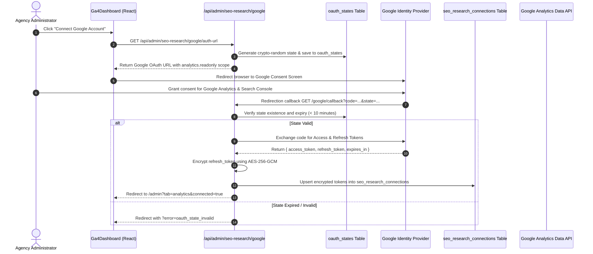

# Google Analytics 4 (GA4) Integration

**Document Version:** 8.3.0 Baseline Draft  
**Inspected Commit:** `e51b0240be6b8a00e491909013475be062c92f5b`  
**Authoritative Backend Files:** `server/ga4Service.ts`, `server/routes/analytics.ts`, `server/routes/seoResearch.ts`, `server/db.ts`  
**Authoritative Frontend Component:** `src/components/admin/Ga4Dashboard.tsx`

---

## 1. Overview & Connection Architecture

The Google Analytics 4 integration connects Dawnexus directly to the official Google Analytics Data API (`v1beta`). It provides verified traffic trends, acquisition channels, landing page engagement, and conversion metrics inside the admin dashboard (`/admin?tab=analytics`) and exposes telemetry to connected AI clients via 9 dedicated MCP tools.

---

## 2. OAuth 2.0 Connection Lifecycle



### 2.1 Security & Token Protection
- **Scopes Requested:** `https://www.googleapis.com/auth/analytics.readonly` and `https://www.googleapis.com/auth/webmasters.readonly`.
- **CSRF Defense:** Cryptographic state generated via `crypto.randomBytes(32).toString('hex')` and persisted in `oauth_states` with an expiration window of 10 minutes.
- **AES-256-GCM Encryption:** Access and refresh tokens are encrypted before being written to SQLite or Supabase PostgreSQL (`server/gscService.ts:encryptPayload`). The encryption key is derived from `ENCRYPTION_KEY` or `ADMIN_PASSWORD`.

---

## 3. Property Discovery & Selection

1. **Property Discovery:** After OAuth authentication, calling `GET /api/admin/analytics/properties` invokes `ga4Service.listProperties()`. The server queries the Google Analytics Admin API (`v1beta`) or extracts accessible account properties from Google identity headers.
2. **Selection & Persistence:** The administrator selects the property corresponding to Dawnexus (e.g. `properties/XXXXXXXXX`). Calling `POST /api/admin/analytics/select-property { propertyId, propertyName }` updates `selected_property_id` in `seo_research_connections`.

---

## 4. Metrics Ingestion & Data Invariants

### 4.1 Ingestion via GA4 Data API (`server/ga4Service.ts`)
The server constructs parameterized `runReport` queries:
- **Dimensions:** `date`, `sessionDefaultChannelGroup`, `pagePath`, `deviceCategory`, `country`.
- **Metrics:** `activeUsers`, `totalUsers`, `sessions`, `screenPageViews`, `engagementRate`, `conversions`.

### 4.2 Enforced Data Invariants
To prevent deceptive or corrupted reporting:
```typescript
// GA4 Strict Invariant Enforcement
if (typeof metric.totalUsers === 'number' && typeof metric.activeUsers === 'number') {
  metric.totalUsers = Math.max(metric.totalUsers, metric.activeUsers);
}
```
**Invariant:** Total users must never be less than active users.

### 4.3 Caching Mechanism (`ga4_analytics_cache` Table)
- Query results are cached in the `ga4_analytics_cache` SQLite table keyed by `property_id`, `report_type`, and `date_range`.
- Cache records have a standard TTL of **6 hours** (`CACHE_TTL_MS = 6 * 60 * 60 * 1000`).
- Clicking **"Sync Now"** in `Ga4Dashboard.tsx` bypasses the cache and forces a live API fetch.

---

## 5. Dashboard Telemetry & Visualizations

The `Ga4Dashboard` component renders 6 reporting panels:
1. **Executive Metric Cards:** Total Users, Active Users, Sessions, Engagement Rate, Page Views, and Conversions.
2. **Traffic Trend Chart:** Interactive SVG visualization plotting daily active users and sessions over 7, 30, or 90 days.
3. **Acquisition Channels:** Horizontal bar breakdown (Organic Search, Direct, Referral, Organic Social, Paid Search).
4. **Top Landing Pages Table:** Page path, sessions, bounce rate, and average engagement duration.
5. **Realtime Monitor:** Active visitors recorded within the preceding 30 minutes.
6. **Device & Regional Geography:** Mobile vs. Desktop vs. Tablet distribution and top user countries.

---

## 6. MCP Tools Integration

Connected AI agents can query the live GA4 integration using these 9 tools:
1. `ga4_get_connection_status`: Verifies OAuth authorization status.
2. `ga4_list_properties`: Enumerates accessible Google Analytics properties.
3. `ga4_get_overview`: High-level summary metrics.
4. `ga4_get_traffic_acquisition`: Source, medium, and channel grouping.
5. `ga4_get_landing_pages`: Entry URLs and performance.
6. `ga4_get_page_performance`: Engagement metrics per URL.
7. `ga4_get_realtime`: Active users in the last 30 minutes.
8. `ga4_get_report`: Custom dimension/metric reports.
9. `ga4_get_analytics_status`: Overall operational telemetry.

