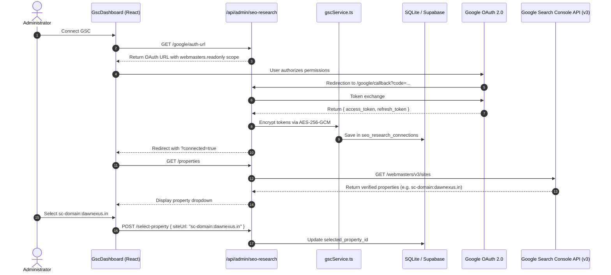

# Google Search Console (GSC) Integration

**Document Version:** 8.3.0 Baseline Draft  
**Inspected Commit:** `e51b0240be6b8a00e491909013475be062c92f5b`  
**Authoritative Backend Files:** `server/gscService.ts`, `server/routes/seoResearch.ts`, `server/db.ts`  
**Authoritative Frontend Component:** `src/components/admin/GscDashboard.tsx`

---

## 1. Overview & Connection Architecture

The Google Search Console integration connects Dawnexus to the official Google Search Console API (Webmasters v3 API). It tracks real organic search performance, queries, impressions, click-through rates (CTR), and average rankings inside `/admin?tab=gsc` and provides organic intelligence to connected AI models through 9 dedicated MCP tools.

---

## 2. OAuth Authentication & API Execution



---

## 3. Data Ingestion & Metric Aggregations

### 3.1 Search Analytics Query Parameters
`GscService.getSearchAnalytics()` executes POST requests against:
```
https://www.googleapis.com/webmasters/v3/sites/{siteUrl}/searchAnalytics/query
```
- **Payload Dimensions:** `['date']`, `['query']`, `['page']`.
- **Row Limits:** Up to 5,000 rows per query request.
- **Date Range Options:** 7 days, 28 days, 90 days, or custom intervals.

### 3.2 Metrics Captured
- `clicks`: Total organic clicks originating from Google Search results.
- `impressions`: Total search impressions in SERP.
- `ctr`: Click-through rate ($\text{clicks} / \text{impressions}$).
- `position`: Average ranking position for query/page pairs.

### 3.3 SQLite Caching Strategy (`gsc_search_analytics_cache` Table)
To avoid Google Search Console API rate limits (1,200 QPM) and ensure sub-second dashboard rendering:
- Telemetry rows are cached in `gsc_search_analytics_cache` indexed by `property_id`, `dimension_type`, and `date_range`.
- Cache TTL is **6 hours**.
- The **"Sync Search Console"** button in `GscDashboard.tsx` forces a live sync and records a job in `seo_research_jobs`.

---

## 4. Opportunity Discovery & Content Recommendations

### 4.1 High-Impression / Low-CTR Opportunity Engine
In `server/routes/seoResearch.ts`:
- Scans queries where `impressions > 100` and `ctr < 0.03` (less than 3% CTR) ranking between positions 4 and 15.
- Flags these as **"High-Leverage Snippet Opportunities"**, indicating high search intent where updating the `<title>` or meta description can produce immediate click growth.

### 4.2 Content Gap & Prompt Generator (`POST /api/admin/seo-research/generate-prompt`)
- Aggregates queries ranking on pages 2–3 (positions 11–25) that lack a dedicated blog article in the CMS inventory.
- Emits structured prompt briefs for copywriters detailing target keyword density, search intent, and user questions.

---

## 5. MCP Tools Integration

Connected AI agents can interact with the live GSC integration using these 9 tools:
1. `get_search_console_opportunities`: Evaluates top queries and content improvement candidates.
2. `gsc_get_connection_status`: Verifies OAuth connection and token validity.
3. `gsc_list_properties`: Lists all verified Google Search Console site properties.
4. `gsc_get_search_analytics`: Executes dimensional Search Console queries.
5. `gsc_get_top_queries`: Returns top-performing search queries.
6. `gsc_get_top_pages`: Returns top landing pages by clicks and impressions.
7. `gsc_get_research_status`: Inspects background sync health.
8. `gsc_run_research_sync`: Dispatches a background Search Console sync job.
9. `gsc_get_research_job`: Checks progress of an active sync job.

