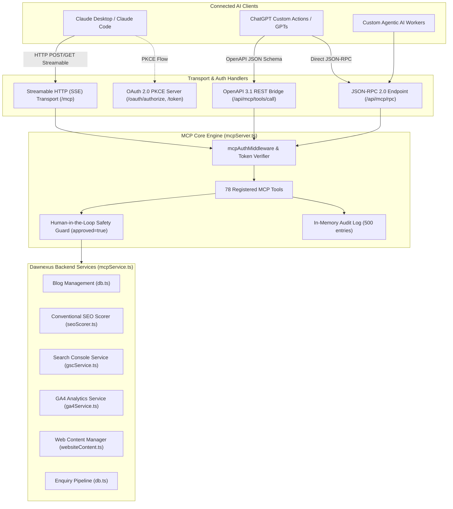

# Model Context Protocol (MCP) Server

**Document Version:** 8.3.0 Baseline Draft  
**Inspected Commit:** `e51b0240be6b8a00e491909013475be062c92f5b`  
**Authoritative Backend Files:** `server/mcpServer.ts`, `server/mcpService.ts`, `server/mcpStreamable.ts`, `server/mcpOAuth.ts`, `server/mcpAuth.ts`  
**Protocol Version:** MCP Protocol 2024-11-05 via `@modelcontextprotocol/sdk` (v1.32.1)

---

## 1. Protocol Architecture & Transports

Dawnexus provides a multi-transport Model Context Protocol implementation supporting Claude Desktop, Claude Code, and ChatGPT:



### 1.1 Supported Endpoints

| Endpoint Path | Transport / Protocol | Target Client | Authentication Method |
| :--- | :--- | :--- | :--- |
| `https://www.dawnexus.in/mcp` | Streamable HTTP (SSE) | Claude Desktop / Claude Code | `Authorization: Bearer <token>` or `x-mcp-api-key` |
| `https://www.dawnexus.in/api/mcp/rpc` | JSON-RPC 2.0 (`POST`) | Claude / ChatGPT / Custom AI | `Authorization: Bearer <token>` or `x-mcp-api-key` |
| `https://www.dawnexus.in/api/mcp/tools/call` | OpenAPI REST POST | ChatGPT Custom Actions | `Authorization: Bearer <token>` or `x-mcp-api-key` |
| `https://www.dawnexus.in/api/mcp/openapi.json`| OpenAPI 3.1 Specification | ChatGPT Discovery | Public read-only schema endpoint |
| `https://www.dawnexus.in/.well-known/oauth-authorization-server` | RFC 8414 Discovery | Remote OAuth Clients | Public discovery endpoint |
| `https://www.dawnexus.in/.well-known/oauth-protected-resource` | RFC 9728 Discovery | Protected Resource | Public discovery endpoint |

---

## 2. Authentication, Safety Guards & Permissions

### 2.1 Dual Token Authentication (`server/mcpAuth.ts`)
Requests are authorized via:
1. **Static MCP Key:** Configured via `process.env.MCP_API_KEY` (with a documented fallback for testing). Accepted in `Authorization: Bearer <key>`, `x-mcp-api-key` header, or query parameters (`?apiKey=<key>`).
2. **Signed OAuth 2.0 Bearer Tokens:** Validated by `verifyOAuthAccessToken()` against dynamic sessions generated via OAuth 2.0 PKCE.

### 2.2 Human-in-the-Loop Safety Guards (`approved: true`)
To prevent autonomous AI agents from inadvertently publishing unverified drafts or modifying live customer content:
- **Write Operations Require Approval:** Tools that mutate state (`schedule_blog_draft`, `publish_blog_post`, `website_publish_approved_changes`) require an explicit parameter:
  ```json
  "approved": true
  ```
- If `approved !== true`, the tool execution is immediately **REJECTED**, logged to the audit trail, and returns an actionable error message.
- **Status Restrictions:**
  - `update_blog_draft`: Prohibited from modifying articles with status `Published` or `Scheduled`.
  - `create_blog_draft`: Restricted to creating articles with status `Draft`. Prohibited from directly creating `Published` or `Scheduled` articles.

---

## 3. Complete Registered Tools Inventory (78 Tools)

All 78 tools are declared in `MCP_TOOLS` (`server/mcpServer.ts`) and orchestrated through `McpService` (`server/mcpService.ts`):

### 3.1 Blog CMS & Writing Tools (17 Tools)
1. `get_blog_categories` (Read-only): Retrieves official categories.
2. `get_existing_articles` (Read-only): Retrieves existing articles, slugs, and internal link targets.
3. `get_weekly_content_context` (Read-only): Aggregates categories, drafts, and link targets for weekly planning.
4. `create_blog_draft` (Write-capable): Creates a new article draft. Enforces valid CMS categories; defaults status to `Draft`.
5. `update_blog_draft` (Write-capable): Updates an existing draft. Prohibits modifying published/scheduled articles.
6. `upload_blog_image` (Write-capable): Uploads and validates an article image.
7. `attach_blog_image` (Write-capable): Sets `featured_image` and `image_alt` on a draft.
8. `verify_blog_image` (Read-only): Confirms image accessibility and valid dimensions.
9. `update_blog_image_metadata` (Write-capable): Updates image alt text and caption.
10. `schedule_blog_draft` (Write-capable): Schedules draft for future publication. Requires `approved: true`, future date/time in Asia/Kolkata, and Conventional SEO score $\ge 90$.
11. `run_seo_quality_check` (Read-only): Runs the technical SEO audit on an article, returning score and checklist.
12. `search_published_blogs` (Read-only): Searches published articles by keyword or category.
13. `get_blog_post` (Read-only): Retrieves a complete article record by numeric `id` or string `slug` (never returns `{}`).
14. `list_blog_posts` (Read-only): Lists articles with pagination, status filters, and sorting.
15. `get_blog_post_status` (Read-only): Returns status, scheduled time, and publication state of an article.
16. `schedule_blog_post` (Write-capable): Schedules an article (alias with approval enforcement).
17. `publish_blog_post` (Write-capable): Immediately publishes an approved article live. Requires `approved: true` and SEO score $\ge 90$.

### 3.2 Google Search Console Tools (9 Tools)
18. `get_search_console_opportunities` (Read-only): Retrieves real GSC query metrics and optimization opportunities.
19. `gsc_get_connection_status` (Read-only): Checks OAuth connection status for GSC.
20. `gsc_list_properties` (Read-only): Lists verified GSC sites.
21. `gsc_get_search_analytics` (Read-only): Queries GSC search analytics for date ranges.
22. `gsc_get_top_queries` (Read-only): Returns top ranking search queries.
23. `gsc_get_top_pages` (Read-only): Returns top organic landing pages.
24. `gsc_get_research_status` (Read-only): Returns status of background sync tasks.
25. `gsc_run_research_sync` (Write-capable): Triggers an asynchronous GSC sync job.
26. `gsc_get_research_job` (Read-only): Polls research job progress by `jobId`.

### 3.3 Google Analytics 4 Tools (9 Tools)
27. `ga4_get_connection_status` (Read-only): Checks OAuth connection status for GA4.
28. `ga4_list_properties` (Read-only): Lists accessible GA4 properties.
29. `ga4_get_overview` (Read-only): Returns active users, sessions, engagement rate, conversions.
30. `ga4_get_traffic_acquisition` (Read-only): Traffic channels and source/medium attribution.
31. `ga4_get_landing_pages` (Read-only): Top entry pages and bounce/engagement metrics.
32. `ga4_get_page_performance` (Read-only): Page views and average engagement time per route.
33. `ga4_get_realtime` (Read-only): Real-time active users count in the last 30 minutes.
34. `ga4_get_report` (Read-only): Custom parameterized GA4 dimensional report.
35. `ga4_get_analytics_status` (Read-only): Overall GA4 integration health.

### 3.4 First-Party Visitor Behaviour & Analytics Tools (15 Tools)
36. `analytics_get_overview` (Read-only): First-party visitor counts, unique sessions, bounce rate.
37. `analytics_get_conversion_funnel` (Read-only): Step-by-step conversion dropoff from pageview to enquiry.
38. `analytics_get_page_performance` (Read-only): Time on page and exit rates per URL.
39. `analytics_get_visitor_journeys` (Read-only): Multi-page click pathways.
40. `analytics_get_exit_analysis` (Read-only): Highest exit pages and abandoned sessions.
41. `analytics_get_click_heatmap` (Read-only): Aggregated click coordinates across screen breakpoints.
42. `analytics_get_scroll_depth` (Read-only): 25%, 50%, 75%, 100% scroll milestones.
43. `analytics_get_form_abandonment` (Read-only): Field-level abandonment analysis on contact forms.
44. `analytics_get_session_replay_summary` (Read-only): Aggregated mouse movement and interaction metrics.
45. `analytics_get_bot_filter_stats` (Read-only): Known scraper filtering and honeypot hits.
46. `analytics_get_tracking_health` (Read-only): Signal ingestion rate and database storage health.
47. `get_visitor_analytics_overview` (Read-only): High-level summary of traffic patterns.
48. `get_conversion_funnel` (Read-only): Funnel stages representation.
49. `get_page_engagement` (Read-only): User engagement duration.
50. `get_chatbot_analytics` (Read-only): AI chat assistant interactions and enquiry conversions.

### 3.5 Web Content Manager Tools (13 Tools)
51. `website_list_editable_pages` (Read-only): Lists editable service landing pages.
52. `website_get_page_content` (Read-only): Retrieves structured section data for a service page.
53. `website_get_page_metadata` (Read-only): Returns SEO title and description for a service page.
54. `website_get_content_version_history` (Read-only): Retrieves historical revision records.
55. `website_create_optimization_draft` (Write-capable): Proposes copy updates without publishing.
56. `website_preview_optimization_draft` (Read-only): Returns proposed copy vs. live copy comparison.
57. `website_get_approval_status` (Read-only): Checks if a content draft has human approval.
58. `website_publish_approved_changes` (Write-capable): Pushes approved draft to live production. Requires `approved: true`.
59. `website_rollback_content_version` (Write-capable): Rolls back a page to an earlier version.
60. `search_website_content` (Read-only): Semantic text search across service page content.
61. `get_website_page` (Read-only): Fetches full page data by slug.
62. `list_services` (Read-only): Returns the 4 core service definitions.
63. `get_service_details` (Read-only): Returns deep service features and offerings.

### 3.6 Public Knowledge & Approved Information Tools (5 Tools)
64. `chatbot_get_public_knowledge` (Read-only): Official brand info, service scopes, and location details.
65. `chatbot_estimate_pricing` (Read-only): Executes project cost calculations based on user requirements.
66. `chatbot_submit_enquiry` (Write-capable): Submits an enquiry generated during an AI chat interaction.
67. `get_approved_business_information` (Read-only): Official legal name, headquarters, and verified contacts.
68. `get_approved_pricing_information` (Read-only): Standard service package pricing and calculator tiers.

### 3.7 Enquiry Management Tools (5 Tools)
69. `enquiries_admin_list` (Read-only): Lists enquiries with status filters (`Unread`, `Contacted`, `Archived`).
70. `list_authorized_enquiries` (Read-only): Authorized enquiry listing with pagination.
71. `get_authorized_enquiry` (Read-only): Retrieves full customer enquiry details by ID.
72. `create_enquiry` (Write-capable): Submits an enquiry with honeypot and phone validation.
73. `get_enquiry_submission_status` (Read-only): Checks status of an enquiry submission.

### 3.8 Advanced SEO & Quality Audit Tools (5 Tools)
74. `seo_audit_content_quality` (Read-only): Information Gain and content quality audit on an article.
75. `seo_audit_ai_discovery` (Read-only): Evaluates search intent, answer blocks, and citation eligibility.
76. `seo_get_content_freshness` (Read-only): Returns content freshness audit and overdue review alerts.
77. `seo_validate_structured_data` (Read-only): Validates JSON-LD schema against Google Rich Results rules.
78. `seo_get_html_payload_report` (Read-only): Audits public routes against the 2 MB edge payload threshold.

---

## 4. Client Compatibility & Configuration Guide

### 4.1 Claude Desktop Configuration
In Claude Desktop's configuration file (`claude_desktop_config.json`):

```json
{
  "mcpServers": {
    "dawnexus": {
      "command": "npx",
      "args": [
        "-y",
        "mcp-remote-client",
        "https://www.dawnexus.in/mcp",
        "--header",
        "x-mcp-api-key: YOUR_MCP_API_KEY"
      ]
    }
  }
}
```

### 4.2 ChatGPT Custom Actions Configuration
1. Open GPT Editor $\to$ **Configure** $\to$ **Add Actions**.
2. Set **Import from URL**: `https://www.dawnexus.in/api/mcp/openapi.json`.
3. Set **Authentication**: API Key $\to$ Custom Header Name: `x-mcp-api-key` $\to$ Enter key.
4. ChatGPT can now execute authorized reads, conventional SEO audits, and submit approved drafts.

