# Security, Authentication & Access Controls

**Document Version:** 8.3.0 Baseline Draft  
**Inspected Commit:** `e51b0240be6b8a00e491909013475be062c92f5b`  
**Authoritative Backend Files:** `server/auth.ts`, `server/mcpAuth.ts`, `server/mcpOAuth.ts`, `server/gscService.ts`, `server/db.ts`

---

## 1. Security Architecture Overview

Dawnexus implements a layered defense model across admin authentication, API endpoints, AI client integrations, external Google OAuth connections, and data persistence:

```mermaid
flowchart TD
    subgraph PublicRequests["Public Traffic"]
        VisitorReq["Public Forms / Ingestion"] --> RateLimiter["Express Rate Limiters (IP-based)"]
        RateLimiter --> HoneypotGuard["Silent Honeypot Trap"]
        HoneypotGuard --> InputSanitizer["DOMPurify & Strict Regex Validation"]
        InputSanitizer --> SQLitePublic["SQLite Public Tables"]
    end

    subgraph AdminRequests["Admin Panel Traffic (/api/admin)"]
        AdminReq["Admin Login (/api/admin/login)"] --> BruteForce["Brute Force Lockout (5 attempts / 15 min)"]
        BruteForce --> TimingSafe["Constant-Time Password Comparison (timingSafeEqual)"]
        TimingSafe --> SessionGen["64-Hex Cryptographic Session Token"]
        SessionGen --> SecureCookie["HttpOnly, Secure, SameSite=Lax Cookie"]
        SecureCookie --> AdminSessionDB["admin_sessions Table (4-hour TTL)"]
    end

    subgraph AIRequests["MCP & AI Traffic (/mcp, /api/mcp)"]
        AIReq["AI Client Request"] --> MCPTokenCheck{"Token Type"}
        MCPTokenCheck -->|Bearer / x-mcp-api-key| StaticKeyAuth["Derived MCP_API_KEY Check"]
        MCPTokenCheck -->|OAuth Access Token| PKCEVerify["OAuth 2.0 PKCE Signed Token Verification"]
        StaticKeyAuth --> HumanApproval{"Write Tool Requested?"}
        PKCEVerify --> HumanApproval
        HumanApproval -->|Yes| RequireApproved["Enforce approved: true Flag"]
        HumanApproval -->|No| AllowRead["Execute Read-Only Tool"]
        RequireApproved --> AuditLog["In-Memory & DB Audit Log"]
    end
```



---

## 2. Administrator Authentication & Session Lifecycle

### 2.1 Password Verification & Brute-Force Defense (`server/auth.ts`)
- **Single Master Password:** Configured via `process.env.ADMIN_PASSWORD` (defaults to dev fallback `'9566'`).
- **Timing Attack Mitigation:** Compares password buffers using `crypto.timingSafeEqual()`:
  ```typescript
  const passwordBuffer = Buffer.from(password);
  const expectedBuffer = Buffer.from(expectedPassword);
  const isMatch = passwordBuffer.length === expectedBuffer.length &&
                  crypto.timingSafeEqual(passwordBuffer, expectedBuffer);
  ```
- **IP Lockout:** A shared memory map (`failedAttemptsMap`) tracks failed logins per client IP. Upon 5 consecutive incorrect passwords, the IP is locked out for **15 minutes** (`HTTP 429 Too Many Requests`).

### 2.2 Session Management (`admin_sessions` Table)
- **Token Generation:** 32 cryptographically secure random bytes rendered as 64 hexadecimal characters:
  ```typescript
  const token = crypto.randomBytes(32).toString('hex');
  ```
- **Session Lifespan:** Valid for **4 hours** (`SESSION_MAX_AGE_HOURS = 4`). Expired sessions are purged during session validation checks.
- **Cookie Security Attributes:**
  - Name: `dawnexus_session`
  - `httpOnly: true` (inaccessible to browser JavaScript / XSS protection)
  - `secure: process.env.NODE_ENV === 'production'` (HTTPS transmission only)
  - `sameSite: 'lax'` (CSRF mitigation)
  - `path: '/'`

---

## 3. External API Token Encryption (AES-256-GCM)

Google Search Console and Google Analytics 4 OAuth access and refresh tokens are stored in the database. To prevent credential theft if a database snapshot is compromised:
- **Cipher Algorithm:** `aes-256-gcm` (Authenticated Symmetric Encryption).
- **Implementation (`server/gscService.ts`):**
  ```typescript
  export function encryptPayload(text: string): string {
    const iv = crypto.randomBytes(16);
    const cipher = crypto.createCipheriv('aes-256-gcm', keyBuffer, iv);
    let encrypted = cipher.update(text, 'utf8', 'hex');
    encrypted += cipher.final('hex');
    const authTag = cipher.getAuthTag();
    return `${iv.toString('hex')}:${authTag.toString('hex')}:${encrypted}`;
  }
  ```
- Each encrypted payload includes a unique Initialization Vector (`iv`) and an Authentication Tag (`authTag`) ensuring ciphertext integrity and confidentiality.

---

## 4. Model Context Protocol (MCP) Security Controls

### 4.1 Token Authentication & Preflight Handling
- All incoming requests to `/mcp`, `/api/mcp/rpc`, and `/api/mcp/tools/call` are gated by `mcpAuthMiddleware` (`server/mcpAuth.ts`).
- Supports Bearer headers, custom `x-mcp-api-key` headers, and signed OAuth 2.0 PKCE tokens.
- CORS preflight (`OPTIONS`) is allowed for browser-based tool discovery.

### 4.2 RFC 7636 OAuth 2.0 PKCE Server (`server/mcpOAuth.ts`)
- Remote clients can authenticate using standard OAuth 2.0 Proof Key for Code Exchange (PKCE).
- Enforces `code_challenge_method: 'S256'`, validating `crypto.createHash('sha256').update(code_verifier).digest('base64url')`.

### 4.3 Human-in-the-Loop Safety Guards
- Tools with write capabilities (`schedule_blog_draft`, `publish_blog_post`, `website_publish_approved_changes`) mandate an explicit parameter: `approved: true`.
- Autonomous calls without this flag are rejected (`HTTP 400`), preventing AI agent runaways.
- Modification of live `Published` articles is strictly blocked via MCP; updates must be made in the admin UI or through explicit republishing workflows.

### 4.4 Audit Trail (`admin_audit_logs` & Memory Cache)
- An in-memory circular buffer (`McpAuditEntry[]`, max 500 records) records caller IP, timestamp, tool name, action category, status (`success`, `failed`, `rejected`), and operation details.

---

## 5. Input Validation, Rate Limiting & Bot Protection

### 5.1 Rate Limiting Middleware (`server/routes/api.ts`)
- **Enquiry Limiter:** 5 requests per 15 minutes per IP (`enquiryLimiter`).
- **Analytics Limiter:** 120 events per minute per IP (`analyticsLimiter`).
- **AI Chatbot Limiter:** 30 messages per 15 minutes per IP (`assistantLimiter`).

### 5.2 XSS Prevention & HTML Sanitization
- All rich text content bodies submitted to the Blog CMS or Web Content Manager are sanitized using `isomorphic-dompurify` prior to database persistence and prior to public SSR rendering.
- All dynamic meta tags (`<title>`, `<meta name="description">`, Open Graph, Twitter) pass through `escapeHtml()` and `escapeAttr()` helper functions in `server/ssrRenderer.ts`, preventing injection through attribute breakout.

