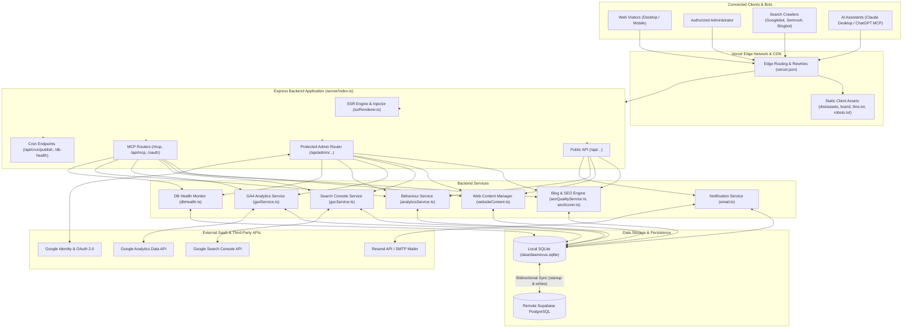

# Dawnexus System Overview

**Document Version:** 8.3.0 Baseline Draft  
**Inspected Commit:** `e51b0240be6b8a00e491909013475be062c92f5b` (`main` branch)  
**Repository Working Tree:** Verified clean  
**Target Environment:** Node.js 24.x LTS / Vercel Serverless / Supabase PostgreSQL  
**Production Domain:** `https://www.dawnexus.in`

---

## 1. Executive Purpose & Scope

Dawnexus is a full-stack digital engineering and marketing application. It serves as both the client-facing public presence for Dawnexus (a web engineering, technical SEO, and AI creative agency based in Coimbatore, Tamil Nadu, India) and an operational internal operations platform.

The system incorporates:
1. **High-Performance Public Website & Single-Page Application (SPA):** Ultra-fast frontend offering an interactive project quotation builder (Website Cost Calculator India in ₹), client showcase portfolios, 4 distinct service landing pages, an Insights Blog hub with 28+ articles, an AI chat widget, and lead-capture enquiry funnels.
2. **Server-Side Rendered (SSR) Metadata & Crawl Injection:** Raw HTML view-source crawlers receive server-injected canonical links, Open Graph tags, Schema.org JSON-LD entities (`Organization`, `WebSite`, `Service`, `BlogPosting`, `WebApplication`), single `<h1>` headers, and crawlable navigation fallback before JavaScript hydration.
3. **Comprehensive Internal Admin Suite:** A secured administrative panel (`/admin`) providing enquiry pipeline management, CSV export, multi-tier notification OTP challenges, a full Blog CMS with calendar and editor, a Web Content Manager for live website text changes, Google Analytics 4 (GA4) integration, Google Search Console (GSC) integration, a first-party visitor behaviour intelligence system (with heatmaps and session replay summaries), and database health telemetry.
4. **Model Context Protocol (MCP) Server:** An enterprise AI bridge exposing 78 registered tools supporting Claude Desktop, Claude Code, and ChatGPT (OpenAPI & Streamable HTTP / SSE JSON-RPC) with token-based access control, cryptographic verification, and strict human-approval safeguards.
5. **Dual-Layer Database Architecture:** Fast zero-latency local SQLite persistence (`better-sqlite3`) paired with remote Supabase PostgreSQL synchronization for cold starts and cloud durability.

---

## 2. Core Technology Stack

| Layer | Technologies & Libraries | Authoritative Configuration / Entry Points |
| :--- | :--- | :--- |
| **Frontend Runtime & Bundler** | React 18.3, TypeScript, Vite 8.3.4, Rolldown / esbuild | `src/main.tsx`, `src/App.tsx`, `vite.config.ts` |
| **UI Styling & Icons** | Tailwind CSS 3.4, Lucide React (`lucide-react`) | `tailwind.config.js`, `src/index.css` |
| **Sanitization & PDF Generation** | DOMPurify (`isomorphic-dompurify`), jsPDF, html2canvas | `src/utils/generateEstimatePdf.ts`, `src/components/admin/BlogEditor.tsx` |
| **Backend Application Framework** | Node.js 24.16, Express 4.x, TypeScript (executed via `tsx`) | `server/index.ts`, `api/index.ts` |
| **Data Access & Databases** | SQLite 3 via `better-sqlite3`, PostgreSQL via `@supabase/supabase-js` | `server/db.ts`, `server/supabase.ts` |
| **AI Protocol & Integrations** | `@modelcontextprotocol/sdk` (v1.32.1), `@google/genai` (Gemini SDK) | `server/mcpServer.ts`, `server/mcpService.ts`, `server/geminiService.ts` |
| **External Google APIs** | Google Search Console API v3, Google Analytics Data API v1beta | `server/gscService.ts`, `server/ga4Service.ts`, `server/routes/seoResearch.ts` |
| **Security & Cryptography** | Native Node.js `crypto` (AES-256-GCM, SHA-256), Cookie Parser | `server/auth.ts`, `server/mcpAuth.ts`, `server/gscService.ts` |
| **Hosting & Deployment** | Vercel Serverless Functions (`iad1`), Vercel Edge CDN | `vercel.json`, `package.json` |

---

## 3. High-Level Architecture Diagram

---

## 4. Key Subsystem Directory Map

- `api/`: Vercel serverless entry point (`api/index.ts`).
- `public/`: Static files served directly by the CDN (`robots.txt`, `llms.txt`, `llms-full.txt`, `site.webmanifest`, brand logos).
- `server/`: Complete backend Express implementation:
  - `server/index.ts`: Primary application configuration, middleware, SSR handling, and server lifecycle.
  - `server/db.ts`: SQLite table declarations, prepared statements, database CRUD, and synchronous operations.
  - `server/supabase.ts`: Supabase PostgreSQL hydration, remote sync, and table migrations.
  - `server/mcpServer.ts`: JSON-RPC protocol implementation and 78 MCP tool definitions.
  - `server/mcpService.ts`: MCP tool handlers and orchestration.
  - `server/mcpStreamable.ts`: Streamable HTTP (SSE) MCP transport for Claude.
  - `server/mcpOAuth.ts`: RFC 8414 & RFC 9728 OAuth 2.0 PKCE implementation for remote MCP clients.
  - `server/seoQualityService.ts`: Conventional Technical SEO audit, Information Gain analysis, and overlapping keyword audits.
  - `server/ssrRenderer.ts`: HTML view-source metadata injection, JSON-LD schema formatting, and crawler fallback body rendering.
  - `server/routes/`: Express route handlers (`admin.ts`, `api.ts`, `analytics.ts`, `seoResearch.ts`).
  - `server/test/`: Comprehensive integration test suites (`npm test`).
- `src/`: Client-side single-page application:
  - `src/App.tsx`: Main React router, lazy route loading, and layout scaffolding.
  - `src/components/public/`: Public website components (Hero, Services, WhyUs, Process, Work, ProductShowcases, ContactForm, Navbar, Footer, AiChatAssistant).
  - `src/components/admin/`: Admin panels (BlogManager, BlogEditor, AdvancedSeoDashboard, Ga4Dashboard, GscDashboard, BehaviourAnalyticsDashboard, ContentEditor, CalculatorSettings, DatabaseHealthDashboard, NotificationSettings).
  - `src/pages/`: Page containers (Services, Calculator, Blog Listing, Blog Post).
  - `src/utils/`: Client utilities (SEO meta updater, tracker, JSON-LD generators).

