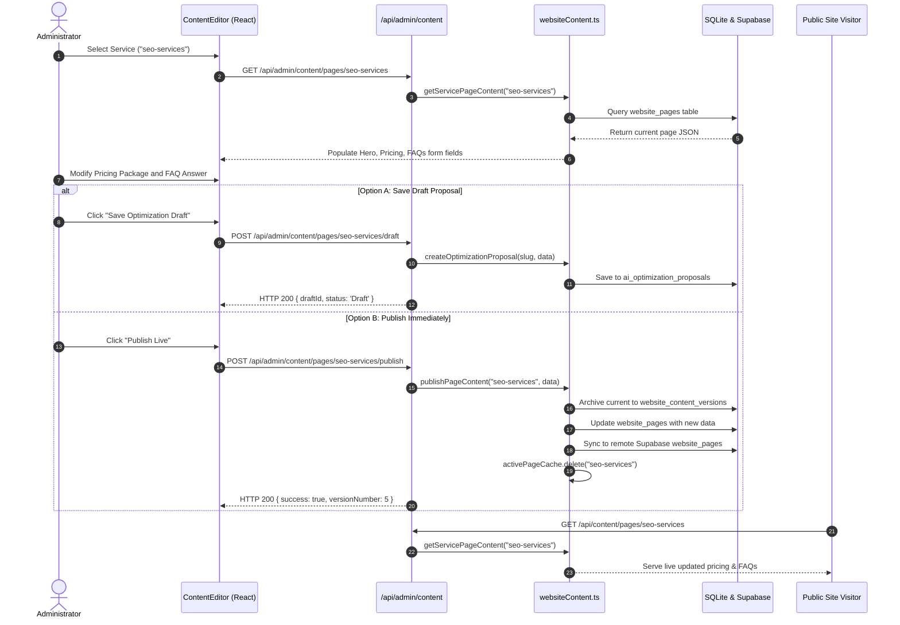

# Web Content Manager (Service Pages CMS)

**Document Version:** 8.3.0 Baseline Draft  
**Inspected Commit:** `e51b0240be6b8a00e491909013475be062c92f5b`  
**Authoritative Backend Files:** `server/websiteContent.ts`, `server/routes/admin.ts`, `server/db.ts`  
**Authoritative Frontend Components:** `src/components/admin/ContentEditor.tsx`, `src/utils/usePageContent.ts`, `src/pages/services/*`

---

## 1. Overview & Operational Purpose

The Web Content Manager (`/admin?tab=content-editor`) allows administrators to update the copy, feature lists, process steps, pricing packages, and FAQs for all 4 core service landing pages without modifying source code, making Git commits, or triggering Vercel rebuilds.

### 1.1 Managed Service Pages
1. `/services/website-design` (Website Design & Development)
2. `/services/seo-services` (Search Engine Optimization)
3. `/services/ai-video-creation` (AI Video Creation & Marketing)
4. `/services/digital-marketing` (Performance Digital Marketing)

---

## 2. Data Architecture & Storage

### 2.1 Database Tables
- **`website_pages`:** Stores the active, live version of each service page. Keyed by `slug` (`TEXT PRIMARY KEY`). Contains JSON-serialized structures for `hero_title`, `hero_subtitle`, `hero_description`, `hero_primary_cta`, `capabilities`, `process_steps`, `pricing_packages`, `faqs`, `cta_section`, `meta_title`, and `meta_description`.
- **`website_content_versions`:** Maintains a historical log of every revision. Tracks `id`, `page_slug`, `version_number`, `content_json`, `created_by`, `change_summary`, and `created_at`.
- **`ai_optimization_proposals`:** Holds proposed copy optimizations generated by AI agents or staff before approval.

### 2.2 In-Memory Fast Cache with Immediate Invalidation
In `server/websiteContent.ts`:
- An in-memory cache map (`activePageCache`) stores parsed page JSON objects.
- When an update or rollback is published, `activePageCache.delete(slug)` invalidates the cache instantly.
- The next visitor request immediately reloads the updated record from SQLite/Supabase, guaranteeing sub-millisecond response times with zero deployment delay.

### 2.3 Safe Default Fallback (`DEFAULT_SERVICE_PAGES`)
If the database is unpopulated or cold-started without Supabase connectivity:
- The system automatically serves `DEFAULT_SERVICE_PAGES` hardcoded in `server/websiteContent.ts`.
- Service pages will never crash with a 500 or display empty blocks.

---

## 3. End-to-End Editing & Publishing Workflow



---

## 4. Rollback Workflow

1. In `ContentEditor.tsx`, the administrator clicks **"Version History"**.
2. The component calls `GET /api/admin/content/pages/:slug/versions`.
3. The table displays previous revisions with timestamps, version numbers, and change summaries.
4. Clicking **"Rollback to this Version"** sends `POST /api/admin/content/pages/:slug/rollback { versionId }`.
5. The backend copies the historical JSON content into the active `website_pages` record and invalidates the cache, restoring the previous page state immediately.

---

## 5. Public Website Ingestion (`src/utils/usePageContent.ts`)

Public landing pages (e.g. `src/pages/services/WebsiteDesignPage.tsx`) consume dynamic content via a custom React hook:
```typescript
const { content, isLoading } = usePageContent('website-design', DEFAULT_CONTENT);
```
- During SSR, initial markup is generated with fallback text.
- On client mount, `usePageContent` calls `GET /api/content/pages/:slug` and merges any published updates seamlessly into the UI.

---

## 6. MCP Tools Integration

Connected AI assistants can inspect, propose, and publish service page revisions using these 13 tools:
1. `website_list_editable_pages`
2. `website_get_page_content`
3. `website_get_page_metadata`
4. `website_get_content_version_history`
5. `website_create_optimization_draft`
6. `website_preview_optimization_draft`
7. `website_get_approval_status`
8. `website_publish_approved_changes` (Requires `approved: true`)
9. `website_rollback_content_version`
10. `search_website_content`
11. `get_website_page`
12. `list_services`
13. `get_service_details`

